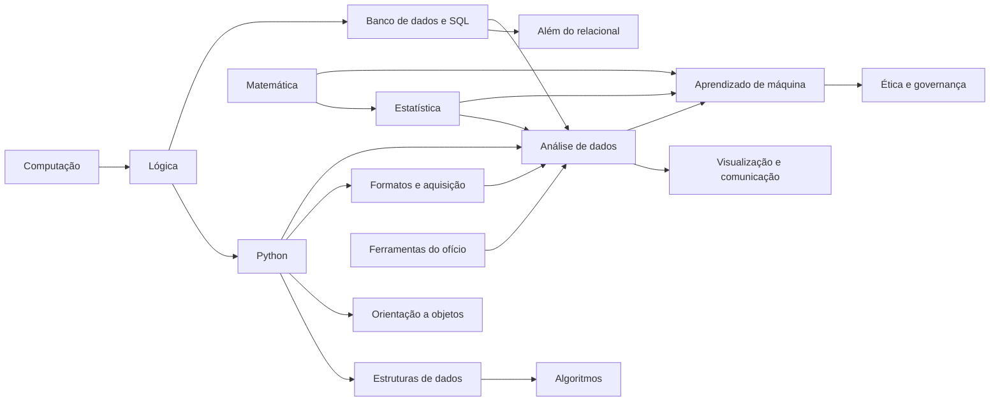

# 05 — Currículo de Ciência de Dados do DOMÍNIO

> O que um cientista de dados precisa dominar, da base ao trabalho, organizado para a plataforma ensinar e cobrar.
> O curso da UFMS guia a ordem e o calendário; o currículo vai além dele. Pesquisa feita em 11/10/2026.

## Sumário

1. [De onde vem este currículo](#1-de-onde-vem-este-currículo)
2. [Linguagens, bancos, formatos e ferramentas](#2-linguagens-bancos-formatos-e-ferramentas)
3. [A estrutura: etapas, trilhas, módulos e conceitos](#3-a-estrutura)
4. [As 16 trilhas](#4-as-16-trilhas)
5. [Catálogo de exercícios](#5-catálogo-de-exercícios)
6. [Projetos integradores](#6-projetos-integradores)
7. [Como a plataforma decide que você domina](#7-como-a-plataforma-decide-que-você-domina)
8. [Como o conteúdo é produzido e verificado](#8-como-o-conteúdo-é-produzido-e-verificado)
9. [O que a plataforma precisa ter para entregar isto](#9-o-que-a-plataforma-precisa-ter)
10. [Material-base e bancos de exercícios](#10-material-base-e-bancos-de-exercícios)
11. [Referências da pesquisa](#11-referências-da-pesquisa)

---

## 1. De onde vem este currículo

O currículo cruza quatro fontes. Nenhuma sozinha basta.

| Fonte | O que ela define | Como entrou aqui |
|---|---|---|
| **ACM, *Computing Competencies for Undergraduate Data Science Curricula* (2021)** | 11 áreas de conhecimento de computação para ciência de dados: Análise e Apresentação; Inteligência Artificial; Sistemas de Big Data; Fundamentos de Computação; Aquisição, Gestão e Governança de Dados; Mineração de Dados; Privacidade, Segurança e Integridade; Aprendizado de Máquina; Profissionalismo; Programação, Estruturas de Dados e Algoritmos; Desenvolvimento e Manutenção de Software. O próprio relatório diz que é preciso somar cálculo, matemática discreta, probabilidade, estatística e álgebra linear. | Cada área da ACM virou uma trilha ou parte de uma trilha. |
| **De Veaux et al., *Curriculum Guidelines for Undergraduate Programs in Data Science* (Annual Review of Statistics, 2017; grupo do PCMI)** | Seis competências: pensamento computacional e estatístico; fundamentos matemáticos; construção e avaliação de modelos; algoritmos e software; curadoria de dados; transferência de conhecimento (comunicação, ética, reprodutibilidade). | Deu o lado estatístico e de modelagem que a ACM deixa de fora: simulação, reamostragem, viés e variância, regularização. |
| **EDISON Data Science Framework (UE, 2017)** | Grupos de competência: análise de dados, engenharia de ciência de dados, gestão de dados, métodos de pesquisa e gestão de projetos, análise de negócio. | Reforçou a gestão de dados (qualidade, governança, linhagem) e o lado de negócio, que é o seu ponto forte de economista. |
| **Mercado e concursos no Brasil** | O cargo de TI e Ciência de Dados da SUSEP 2025 (Cebraspe) pôs 25 questões de Ciência de Dados e Banco de Dados ao lado de Engenharia de Software, Segurança, Infraestrutura e Gestão de TI, e mais Lógica e Estatística nos conhecimentos gerais. Nas pesquisas de desenvolvedores de 2025, Python e SQL estão entre as linguagens mais usadas, e PostgreSQL é o banco mais usado. | Decidiu as prioridades (SQL e Python primeiro, PostgreSQL como banco de referência) e os itens Certo/Errado no estilo Cebraspe em toda trilha. |

Conclusão da pesquisa, em uma frase: **cientista de dados é quem sabe tirar uma resposta confiável de dados bagunçados.** Para isso precisa de três pernas (programar, entender estatística e matemática, conhecer o problema) e de um chão comum: lógica, bancos de dados e ferramentas de trabalho. O DOMÍNIO cobre as três pernas e o chão.

---

## 2. Linguagens, bancos, formatos e ferramentas

### 2.1 Linguagens

| Linguagem | Papel | Profundidade exigida | Onde roda no app |
|---|---|---|---|
| **Python** | Linguagem principal: programação, análise, modelos | Domínio completo | Pyodide (navegador), com NumPy, pandas, SciPy, scikit-learn e Matplotlib |
| **SQL** | Linguagem de consulta a dados; a mais cobrada em vaga e concurso | Domínio completo, incluindo janelas e CTE | SQLite (sql.js) ou PostgreSQL (PGlite), e DuckDB para análise |
| **Shell (Bash)** | Mexer em arquivos, rodar programas, automatizar | Uso diário: navegar, filtrar, encadear | Simulado no app; prática real no seu computador |
| **Java** | Linguagem da disciplina de POO da UFMS | O suficiente para a prova e para ler código | Itens de leitura (prever saída, Parsons, ache o erro) |
| **Expressões regulares** | Achar e extrair padrões em texto | Uso prático | Python `re` no Pyodide |
| **Markdown e YAML** | Escrever relatórios, configurar projetos | Uso prático | Editor do app |
| **R** | Alternativa ao Python na estatística | Só reconhecer e ler | Fora do escopo de prática |

### 2.2 Bancos e motores de dados

| Motor | Modelo | Por que aprender | Trilha |
|---|---|---|---|
| **SQLite** | Relacional, um arquivo | Aprender SQL sem servidor; está em todo celular | BD |
| **PostgreSQL** | Relacional, servidor | Padrão de mercado e de concurso; referência do SQL do app | BD |
| **DuckDB** | Relacional colunar, para análise | Consultas analíticas rápidas sobre CSV e Parquet grandes | NSQ, AD |
| **MongoDB** | Documentos (JSON) | Dados sem esquema fixo; Módulo 4 de BD na UFMS | NSQ |
| **Redis** | Chave-valor em memória | Cache e contadores; conceito cobrado em prova | NSQ |
| **Cassandra** | Coluna larga | Escala e escrita distribuída; citado na bibliografia da UFMS | NSQ (conceito) |
| **Neo4j** | Grafo | Relações como dado principal; citado na bibliografia da UFMS | NSQ (conceito) |
| **Data warehouse em nuvem** (BigQuery, Snowflake, Redshift) | Colunar distribuído | Onde muitas empresas guardam os dados | NSQ (conceito) |
| **Spark** | Processamento distribuído | Quando o dado não cabe em uma máquina | NSQ (conceito) |

### 2.3 Formatos de dados

CSV e TSV · JSON e JSON Lines · XML e HTML · planilhas Excel · Parquet · Arrow · SQL (dump) · texto puro e codificações (UTF-8, Latin-1) · datas e fusos (ISO 8601) · GeoJSON · imagem como matriz de pixels · formatos de modelo (pickle e seus riscos). Cada formato tem módulo na trilha FMT, com leitura, escrita, armadilhas e quando usar.

### 2.4 Ferramentas do ofício

Terminal · Git e GitHub · Jupyter · VS Code · ambientes virtuais e gerenciadores de pacote (venv, pip, uv) · pytest · Docker (conceito e uso básico) · orquestração de pipelines (conceito: Airflow) · transformação em SQL versionado (conceito: dbt) · nuvem (conceito: armazenamento de objetos, computação, permissões).

---

## 3. A estrutura

### 3.1 Quatro níveis

- **Etapa:** fase de formação (5 no total). Diz o que vem antes do quê no geral.
- **Trilha:** um assunto (16 no total), como Banco de dados e SQL. Tem pré-requisitos de outras trilhas.
- **Módulo:** um bloco fechado dentro da trilha, com uma **tarefa de domínio** (o que você precisa conseguir fazer sozinho).
- **Conceito:** a menor unidade ensinável. Uma lição por conceito, de 3 a 7 minutos (regra 2 do CLAUDE.md).

### 3.2 Identificadores

Trilha em sigla, módulo em dois dígitos, conceito pela posição no módulo: `BD.07.04` é o quarto conceito do módulo 7 de Banco de dados (`HAVING`). **A lista é só de acréscimo:** conceito novo vai para o fim do módulo, para os identificadores (e o progresso salvo) nunca mudarem.

### 3.3 As cinco etapas

| Etapa | Nome | O que você passa a conseguir | Trilhas que entram |
|---|---|---|---|
| 1 | **Base** | Escrever programas pequenos corretos, consultar uma tabela, ler um gráfico com senso crítico | CMP, LOG, PY (01–04), BD (01–06), MAT (01–03), EST (01–02), ENG (01–02) |
| 2 | **Programar de verdade** | Organizar código em funções e classes, escolher a estrutura certa, juntar tabelas, modelar um banco | PY (05–14), ED, ALG, BD (07–14, 18), POO, MAT (04–06), EST (03–05), ENG (03–05) |
| 3 | **Trabalhar com dados** | Buscar dados de qualquer formato, limpar, analisar e mostrar | FMT, AD (01–08), VIS (01–05), BD (15–17), NSQ (01–03), EST (06–10), MAT (07–08) |
| 4 | **Modelar** | Construir, avaliar e explicar modelos preditivos | ML, MAT (09–10), EST (11–12), AD (09–10) |
| 5 | **Profissão** | Entregar análise reproduzível e em produção, com ética e boa comunicação | ENG (06–10), BD (19–20), NSQ (04–07), ETI, VIS (06–07) |

### 3.4 Ligação com a UFMS e com concursos

Cada módulo tem duas etiquetas: **UFMS** (a disciplina em que o assunto cai; ver `01_MAPA`) e **Concurso** (a área de edital em que costuma aparecer). Quando chega uma AP, o app sobe na fila os módulos com a etiqueta da disciplina. Fora disso, a ordem é a das etapas.

---

## 4. As 16 trilhas

Formato de cada trilha: por que importa, pré-requisitos, onde roda, e uma tabela de módulos. Em cada módulo: os conceitos (um por lição), os exercícios típicos e a **tarefa de domínio**.

Siglas de exercício (detalhes na seção 5): **CE** Certo/Errado · **ME** múltipla escolha · **CP** completar · **PA** Parsons (ordenar linhas) · **PS** prever a saída · **AE** ache o erro · **RT** rastreio (teste de mesa) · **CD** escrever código com testes · **SQ** consulta SQL corrigida pelo resultado · **NU** resposta numérica · **MD** modelar (diagrama) · **IN** interpretar resultado · **GR** escolher ou criticar gráfico · **EX** explicar com suas palavras · **FC** cartão de revisão · **SI** simular estrutura (operar pilha, árvore, fila na tela).

### 4.1 CMP — Fundamentos de computação

**Por que importa:** explica por que `0.1 + 0.2` não dá `0.3`, por que um arquivo abre com acentos quebrados e por que um programa fica sem memória. **Pré-requisitos:** nenhum. **Roda em:** explicações visuais e Python. **UFMS:** ICC. **Concurso:** Infraestrutura de TI, Fundamentos.

| Módulo | Conceitos | Exercícios | Tarefa de domínio |
|---|---|---|---|
| CMP.01 Representação numérica | bit e byte; base 2, 10 e 16; conversão entre bases; inteiros com sinal (complemento de dois); estouro (overflow); ponto flutuante (IEEE 754) e arredondamento | NU, CE, PS | Converter números entre bases e explicar por que `0.1 + 0.2 != 0.3` |
| CMP.02 Texto | caractere e código; ASCII; Unicode; UTF-8 e Latin-1; "mojibake" (acento quebrado); normalização de acentos | PS, AE, CE | Diagnosticar e corrigir um arquivo com acentos quebrados |
| CMP.03 Lógica digital | portas lógicas; tabela-verdade; circuitos combinacionais; somador | RT, NU, CE | Montar a tabela-verdade de um circuito pequeno |
| CMP.04 Arquitetura | CPU, memória e armazenamento; hierarquia de memória e cache; ciclo de instrução; 32 e 64 bits | CE, ME | Explicar por que ler do disco é mais lento que da memória e o que isso muda numa análise |
| CMP.05 Sistemas operacionais | processo e thread; memória virtual; sistema de arquivos; caminhos absolutos e relativos; permissões | CE, PS | Navegar e organizar arquivos por caminho sem interface gráfica |
| CMP.06 Redes e web | IP, DNS e portas; cliente e servidor; HTTP (métodos, códigos de status, cabeçalhos); HTTPS; o que é uma API | CE, ME, IN | Ler uma resposta HTTP e dizer o que aconteceu |
| CMP.07 Como o código roda | compilador, interpretador e bytecode; máquina virtual (JVM, CPython) | CE, ME | Explicar a diferença entre executar Java e Python |

### 4.2 LOG — Lógica de programação

**Por que importa:** é a base de tudo o que vem depois; quem trava aqui trava em todas as linguagens. **Pré-requisitos:** nenhum. **Roda em:** Python no Pyodide, com rastreio visual de variáveis. **UFMS:** Algoritmos I e II. **Concurso:** Lógica de programação, Raciocínio lógico.

| Módulo | Conceitos | Exercícios | Tarefa de domínio |
|---|---|---|---|
| LOG.01 Algoritmo | o que é algoritmo; entrada, processamento e saída; pseudocódigo; fluxograma; teste de mesa | RT, PA, EX | Escrever o algoritmo de um problema do dia a dia e testá-lo à mão |
| LOG.02 Variáveis e tipos | variável como nome para um valor; atribuição; tipos primitivos; conversão de tipo; constantes | PS, RT, AE | Prever o valor de cada variável após uma sequência de atribuições |
| LOG.03 Operadores e expressões | aritméticos; divisão inteira e resto; relacionais; lógicos (e, ou, não); precedência; curto-circuito | PS, NU, CE | Avaliar à mão expressões mistas sem errar a precedência |
| LOG.04 Lógica booleana | tabela-verdade; leis de De Morgan; simplificar condições; condição composta | RT, CE, CP | Reescrever uma condição negada usando De Morgan |
| LOG.05 Decisão | se e senão; decisões encadeadas; escolha múltipla; casos de borda | PA, AE, CD | Classificar entradas em faixas sem lacunas nem sobreposições |
| LOG.06 Repetição | laço com contador; laço com condição; acumulador; contador; sentinela; laços aninhados; parada e laço infinito | RT, PS, CD | Resolver problemas de soma, contagem, máximo e busca com laços |
| LOG.07 Funções | definir e chamar; parâmetros e retorno; escopo; efeito colateral; função pura | PS, AE, CD | Quebrar um programa em funções que se testam separadas |
| LOG.08 Decomposição | dividir o problema; resolver o caso pequeno primeiro; refinamento sucessivo | PA, EX, CD | Partir um enunciado médio em subproblemas e implementar |
| LOG.09 Depuração | ler mensagem de erro; erro de sintaxe, de execução e de lógica; imprimir para investigar; isolar o erro | AE, EX | Achar e corrigir três erros diferentes num programa curto |

### 4.3 PY — Python

**Por que importa:** é a ferramenta de trabalho do cientista de dados. **Pré-requisitos:** LOG.01–LOG.07. **Roda em:** Pyodide, com testes automáticos. **UFMS:** Algoritmos II, Estrutura de Dados, Introdução à Ciência de Dados. **Concurso:** Linguagens de programação.

| Módulo | Conceitos | Exercícios | Tarefa de domínio |
|---|---|---|---|
| PY.01 Primeiros passos | interpretador e REPL; script; `print` e `input`; comentários; indentação como bloco; PEP 8 | PS, AE | Escrever e rodar um script que lê dados e responde |
| PY.02 Números e textos | `int`, `float`, `bool`; `str` como sequência; fatiamento; métodos de string; f-strings; imutabilidade | PS, CP, CD | Limpar e formatar uma lista de nomes e valores |
| PY.03 Listas e tuplas | lista; índice negativo; fatias; métodos; mutabilidade; tupla; desempacotamento | PS, RT, CD | Manipular listas sem confundir cópia e referência |
| PY.04 Dicionários e conjuntos | dicionário; chave e valor; iterar `items()`; `get` com padrão; conjunto; operações de conjunto | PS, CD, SI | Contar ocorrências e agrupar valores com dicionário |
| PY.05 Referências e mutabilidade | nome aponta para objeto; `is` e `==`; apelidos (aliasing); cópia rasa e profunda; argumento padrão mutável | PS, AE, EX | Explicar um bug causado por lista compartilhada |
| PY.06 Funções a fundo | argumentos posicionais e nomeados; `*args` e `**kwargs`; `lambda`; funções como valor; `sorted` com `key`; closures | PS, CD | Ordenar e filtrar registros passando funções |
| PY.07 Compreensões e iteração | compreensão de lista, dicionário e conjunto; `enumerate`; `zip`; iteradores; geradores e `yield` | CP, PS, CD | Reescrever laços em compreensões legíveis e processar dado grande com gerador |
| PY.08 Erros e exceções | `try`, `except`, `else`, `finally`; exceções comuns; lançar exceção; validar entrada | AE, PS, CD | Tornar um programa robusto a entradas ruins |
| PY.09 Arquivos | abrir com `with`; modos de abertura; ler linha a linha; escrever; codificação; `pathlib` | CD, AE | Ler um arquivo de texto, processar e gravar o resultado |
| PY.10 Módulos e pacotes | `import`; módulos da biblioteca padrão (`math`, `random`, `datetime`, `collections`, `itertools`, `json`, `csv`, `re`); criar o seu módulo; `if __name__ == "__main__"` | ME, CD | Organizar um programa em dois módulos |
| PY.11 Classes em Python | classe e objeto; `__init__`; atributos e métodos; `__repr__` e `__str__`; `dataclass` | PS, CD | Modelar registros do domínio com `dataclass` |
| PY.12 Tipagem e qualidade | anotações de tipo; `mypy` (conceito); docstrings; nomes bons; funções pequenas | AE, EX | Anotar e documentar um módulo existente |
| PY.13 Testes | `assert`; `pytest`; caso normal, de borda e de erro; testar antes de corrigir | CD, EX | Escrever testes que pegam um bug antes da correção |
| PY.14 Expressões regulares | classes de caracteres; quantificadores; grupos; `findall`, `sub`; validar e extrair | CP, CD, PS | Extrair datas, valores e e-mails de texto livre |

### 4.4 ED — Estruturas de dados

**Por que importa:** escolher a estrutura certa é o que separa um programa que roda em 1 segundo de um que roda em 1 hora; e é por isso que `dict`, `set` e índices de banco são rápidos. **Pré-requisitos:** PY.01–PY.06, ALG.01. **Roda em:** Python, com simulação visual. **UFMS:** Estrutura de Dados. **Concurso:** Estruturas de dados.

| Módulo | Conceitos | Exercícios | Tarefa de domínio |
|---|---|---|---|
| ED.01 Tipos abstratos | tipo abstrato de dados; interface e implementação; operações e custos | CE, EX | Descrever uma estrutura pelas operações e custos, sem falar de código |
| ED.02 Vetores | vetor contíguo; acesso por índice em O(1); inserção no meio em O(n); vetor dinâmico e realocação | SI, NU, CE | Explicar por que `append` é rápido e `insert(0, x)` é lento |
| ED.03 Listas ligadas | nó e ponteiro; lista simples, dupla e circular; inserção e remoção; comparação com vetor | SI, RT, CD | Implementar inserção e remoção numa lista ligada |
| ED.04 Pilhas | LIFO; empilhar e desempilhar; pilha de chamadas; parênteses balanceados; notação pós-fixa | SI, CD, CE | Validar expressões com parênteses usando pilha |
| ED.05 Filas | FIFO; fila circular; `deque`; fila de prioridade (conceito) | SI, CD | Simular uma fila de atendimento |
| ED.06 Tabelas hash | função de espalhamento; colisão; encadeamento; endereçamento aberto; fator de carga; por que `dict` é O(1) em média | SI, NU, CE | Calcular posições, tratar colisões e explicar o custo médio |
| ED.07 Árvores | raiz, folha, altura, nível; árvore binária; percursos (pré, em e pós-ordem; por nível) | SI, RT, CD | Percorrer uma árvore à mão nos quatro percursos |
| ED.08 Árvore binária de busca | propriedade de ordem; busca, inserção e remoção; árvore degenerada | SI, CD, CE | Inserir e remover numa ABB e prever o formato |
| ED.09 Árvores balanceadas | AVL e fator de balanceamento; rotações; árvore B e o índice de banco | SI, CE | Explicar por que o índice de um banco é uma árvore B |
| ED.10 Heaps | heap mínimo e máximo; subir e descer; fila de prioridade; `heapq` | SI, CD | Manter os k maiores valores de um fluxo com heap |
| ED.11 Grafos | vértice e aresta; dirigido e ponderado; lista e matriz de adjacência | SI, MD, CE | Representar uma rede pequena nas duas formas |
| ED.12 Matrizes | matriz densa e esparsa; armazenamento por linha e por coluna; por que o pandas e o NumPy são colunares | CE, EX | Escolher a representação certa para uma matriz quase toda de zeros |

### 4.5 ALG — Algoritmos e complexidade

**Por que importa:** dá a linguagem para dizer se uma solução escala e é cobrado em entrevistas e concursos. **Pré-requisitos:** PY.01–PY.07. **Roda em:** Python, com contagem de operações e gráficos de tempo. **UFMS:** Algoritmos II, Estrutura de Dados. **Concurso:** Algoritmos e complexidade.

| Módulo | Conceitos | Exercícios | Tarefa de domínio |
|---|---|---|---|
| ALG.01 Custo | contar operações; melhor, pior e caso médio; notação O; classes comuns (1, log n, n, n log n, n², 2ⁿ); custo de memória | NU, ME, CE | Dar a complexidade de trechos de código e justificar |
| ALG.02 Busca | busca linear; busca binária; pré-condição de ordenação | RT, CD, NU | Implementar a busca binária sem erro de limite |
| ALG.03 Ordenação simples | seleção; inserção; bolha; estabilidade | RT, SI, CE | Rastrear cada algoritmo numa lista pequena |
| ALG.04 Recursão | caso base e passo; pilha de chamadas; recursão e iteração; recursão de cauda (conceito) | RT, CD, AE | Escrever funções recursivas corretas e rastreá-las |
| ALG.05 Dividir e conquistar | merge sort; quicksort e pivô; custo n log n | RT, SI, CE | Explicar quando o quicksort degrada |
| ALG.06 Ordenação por contagem | counting sort; limite de n log n para comparação | CE, NU | Dizer quando dá para ordenar em tempo linear |
| ALG.07 Gulosos | escolha gulosa; troco; agendamento de intervalos; quando falha | RT, CE | Mostrar um caso em que o guloso erra |
| ALG.08 Programação dinâmica | subproblemas sobrepostos; memorização; tabela; mochila e maior subsequência comum (introdução) | RT, CD | Transformar uma recursão lenta numa solução memorizada |
| ALG.09 Grafos | busca em largura; busca em profundidade; caminho mínimo (Dijkstra); ordenação topológica | SI, RT, CD | Achar o caminho mínimo num grafo pequeno à mão e em código |
| ALG.10 Medir na prática | `timeit`; crescimento empírico; vetorização como algoritmo melhor | CD, IN | Comparar duas soluções medindo o tempo para tamanhos crescentes |

### 4.6 BD — Bancos de dados relacionais e SQL

**Por que importa:** quase todo dado de empresa mora num banco relacional; SQL é a habilidade mais pedida em vagas de dados e a mais cobrada em concursos de TI. **Pré-requisitos:** LOG.03–LOG.04. **Roda em:** banco de estudo no navegador, correção pelo conjunto de linhas. **UFMS:** Banco de Dados. **Concurso:** Banco de dados (sempre presente).

| Módulo | Conceitos | Exercícios | Tarefa de domínio |
|---|---|---|---|
| BD.01 Por que bancos | dado, informação e SGBD; problemas de planilhas e arquivos soltos; independência de dados; arquitetura de três esquemas | CE, ME | Explicar o que um SGBD resolve que uma planilha não resolve |
| BD.02 Modelo relacional | relação, tupla e atributo; domínio; esquema e instância; chave candidata, primária e estrangeira; integridade de entidade e referencial | CE, MD, AE | Identificar as chaves e as ligações do esquema do banco de estudo |
| BD.03 Primeira consulta | `SELECT` e `FROM`; colunas e `*`; apelido com `AS`; expressões; `DISTINCT` | SQ, PS | Responder perguntas simples numa tabela |
| BD.04 Filtrar | `WHERE`; comparação; `AND`, `OR`, `NOT` e precedência; `IN`; `BETWEEN`; `LIKE`; aspas simples para texto | SQ, AE, CE | Escrever filtros compostos sem erro de aspas nem de precedência |
| BD.05 NULL | o que é NULL; lógica de três valores; `IS NULL`; NULL em comparações e contas; `COALESCE` | PS, AE, CE | Prever o resultado de filtros com NULL |
| BD.06 Ordenar e limitar | `ORDER BY` com várias colunas; `ASC` e `DESC`; `LIMIT` e `OFFSET`; onde ficam os NULL | SQ, PS | Montar rankings e páginas de resultado |
| BD.07 Agregação | `COUNT`, `SUM`, `AVG`, `MIN`, `MAX`; `COUNT(*)` e `COUNT(coluna)`; `GROUP BY`; `HAVING`; ordem lógica de execução | SQ, PS, AE | Resumir dados por grupo e filtrar grupos |
| BD.08 Junções | produto cartesiano; `INNER JOIN`; `LEFT JOIN`; `RIGHT` e `FULL JOIN`; autojunção; junção com várias tabelas; linhas duplicadas por junção | SQ, PS, AE, SI | Cruzar as quatro tabelas do banco de estudo sem perder nem duplicar linhas |
| BD.09 Subconsultas | subconsulta escalar; em `WHERE` com `IN` e `EXISTS`; correlacionada; em `FROM` | SQ, PS | Resolver a mesma pergunta com junção e com subconsulta |
| BD.10 Operações de conjunto | `UNION` e `UNION ALL`; `INTERSECT`; `EXCEPT`; compatibilidade de colunas | SQ, CE | Comparar dois conjuntos de alunos ou questões |
| BD.11 Funções úteis | texto (`UPPER`, `SUBSTR`, `TRIM`, concatenação); datas; `CASE WHEN`; conversão de tipo | SQ, CP | Criar faixas e rótulos dentro da consulta |
| BD.12 Modelagem conceitual | entidade, atributo, relacionamento; cardinalidade (1:1, 1:N, N:M); entidade fraca; diagrama ER; passar do ER para tabelas | MD, CE | Modelar um caso pequeno do zero e gerar as tabelas |
| BD.13 Normalização | dependência funcional; anomalias de inserção, atualização e remoção; 1FN, 2FN, 3FN e FNBC; quando desnormalizar | MD, CE, EX | Levar uma tabela "planilhão" até a 3FN |
| BD.14 Criar e alterar | `CREATE TABLE`; tipos de dados; restrições (`PRIMARY KEY`, `FOREIGN KEY`, `NOT NULL`, `UNIQUE`, `CHECK`); `INSERT`, `UPDATE`, `DELETE`; `ALTER TABLE` | SQ, AE | Criar o esquema do banco de estudo com todas as restrições |
| BD.15 SQL analítico | CTE com `WITH`; CTE recursiva; funções de janela (`ROW_NUMBER`, `RANK`, `LAG`, `LEAD`, somas acumuladas, `PARTITION BY`) | SQ, PS | Calcular ranking por disciplina e evolução das respostas no tempo |
| BD.16 Transações | ACID; `BEGIN`, `COMMIT`, `ROLLBACK`; concorrência; níveis de isolamento e anomalias (leitura suja, não repetível, fantasma) | CE, ME, EX | Explicar o que acontece com duas transferências simultâneas |
| BD.17 Desempenho | índice e árvore B; quando o índice ajuda e quando atrapalha; plano de execução (`EXPLAIN`); seletividade | IN, CE | Ler um plano de execução e propor um índice |
| BD.18 Álgebra relacional | seleção, projeção, junção, união, diferença, renomeação; equivalência com SQL | CE, CP | Traduzir consultas entre álgebra relacional e SQL (cai em concurso) |
| BD.19 Visões, permissões e rotinas | `VIEW`; `GRANT` e `REVOKE`; procedimentos e gatilhos (conceito) | CE, SQ | Criar uma visão para um relatório recorrente |
| BD.20 Analítico e transacional | OLTP e OLAP; data warehouse; modelo estrela e floco de neve; fato e dimensão; ETL e ELT | MD, CE | Desenhar um modelo estrela para as respostas do banco de estudo |

### 4.7 NSQ — Dados além do relacional

**Por que importa:** nem todo dado cabe numa tabela, e nem todo volume cabe num computador. **Pré-requisitos:** BD.01–BD.08. **Roda em:** DuckDB no navegador para colunar; simulação para os demais. **UFMS:** Banco de Dados (Módulo 4, NoSQL). **Concurso:** Big data, NoSQL.

| Módulo | Conceitos | Exercícios | Tarefa de domínio |
|---|---|---|---|
| NSQ.01 Por que NoSQL | limites do relacional; esquema flexível; escala horizontal; teorema CAP; consistência eventual; BASE e ACID | CE, ME | Escolher o tipo de banco para cinco cenários e justificar |
| NSQ.02 Documentos | documento JSON; coleção; consulta e agregação no MongoDB; embutir ou referenciar | PS, CE, MD | Modelar o banco de estudo como documentos e consultar |
| NSQ.03 Colunar e análise | armazenamento por linha e por coluna; compressão; Parquet; DuckDB consultando arquivo direto | SQ, IN | Consultar um Parquet grande com DuckDB e explicar a velocidade |
| NSQ.04 Chave-valor e cache | Redis; expiração; contadores; quando usar cache | CE | Desenhar um cache para uma consulta cara |
| NSQ.05 Coluna larga e grafo | Cassandra (conceito); Neo4j e consultas de caminho (conceito) | CE, ME | Reconhecer problemas que pedem grafo |
| NSQ.06 Big data | volume, velocidade e variedade; processamento distribuído; MapReduce; Spark e DataFrames distribuídos (conceito); data lake e lakehouse | CE, EX | Explicar como uma contagem roda dividida em muitas máquinas |
| NSQ.07 Fluxos | dado em lote e em fluxo; fila de mensagens (conceito: Kafka); janela de tempo | CE | Dizer quando um problema pede processamento contínuo |

### 4.8 FMT — Formatos e aquisição de dados

**Por que importa:** o dado nunca chega pronto; boa parte do trabalho é trazer e interpretar. **Pré-requisitos:** PY.09, CMP.02. **Roda em:** Pyodide com arquivos de exemplo. **UFMS:** Introdução à Ciência de Dados. **Concurso:** Ciência de dados (coleta e integração).

| Módulo | Conceitos | Exercícios | Tarefa de domínio |
|---|---|---|---|
| FMT.01 CSV | separador, aspas e escape; cabeçalho; ponto e vírgula e vírgula decimal (padrão brasileiro); codificação; módulo `csv` e `pandas.read_csv` | AE, CD, PS | Ler sem erro um CSV brasileiro com acentos, `;` e vírgula decimal |
| FMT.02 JSON | objeto, lista e tipos; aninhamento; JSON Lines; achatar estrutura aninhada | PS, CD | Transformar um JSON aninhado em tabela |
| FMT.03 Excel e planilhas | abas; células mescladas; datas como número; armadilhas de planilha | AE, CD | Extrair uma tabela limpa de uma planilha mal formatada |
| FMT.04 XML e HTML | árvore de elementos; atributos; seletores; extrair tabela de página | CD, PS | Extrair uma tabela de uma página HTML salva |
| FMT.05 Parquet e Arrow | formato colunar; esquema e tipos; compressão; partição | CE, CD | Converter CSV para Parquet e comparar tamanho e velocidade |
| FMT.06 Datas e horas | ISO 8601; fuso horário; data sem hora; `datetime`; conversão e aritmética de datas | PS, AE, CD | Corrigir uma série com datas em formatos misturados |
| FMT.07 APIs | REST; requisição e resposta; parâmetros; paginação; autenticação por chave; limites de taxa | CD, IN | Baixar uma série completa de uma API pública paginada |
| FMT.08 Raspagem | quando é permitido (termos de uso, `robots.txt`); requisição; leitura de HTML; respeitar o servidor | CE, CD | Coletar dados de uma página permitida, sem sobrecarregá-la |
| FMT.09 Dados públicos brasileiros | portal dados.gov.br; API do IBGE; séries do Banco Central (SGS); microdados do INEP; Portal da Transparência; dicionários de dados | IN, CD | Montar uma base a partir de duas fontes oficiais com dicionário de dados |
| FMT.10 Texto como dado | tokenização; contagem de palavras; n-gramas; stop words; TF-IDF | CD, PS | Comparar documentos por TF-IDF |
| FMT.11 Imagem como dado | pixel; canais; matriz e tensor; operações simples | PS, CD | Fazer operações básicas numa imagem como matriz NumPy |
| FMT.12 Serialização | `pickle` e seus riscos; JSON para troca; versões de esquema | CE | Escolher formato de troca seguro entre sistemas |

### 4.9 MAT — Matemática para dados

**Por que importa:** modelos são matemática; sem ela você só aperta botões. Foco em intuição geométrica e em cálculo com código, como pede o grupo do PCMI. **Pré-requisitos:** nenhum para MAT.01–03. **Roda em:** Python (NumPy) com visualização. **UFMS:** GAAL, Matemática Básica, Cálculo. **Concurso:** Raciocínio lógico e matemático.

| Módulo | Conceitos | Exercícios | Tarefa de domínio |
|---|---|---|---|
| MAT.01 Conjuntos e funções | conjunto, pertinência, operações; produto cartesiano; função, domínio e imagem; composição; inversa | CE, NU | Resolver problemas de conjuntos e composição |
| MAT.02 Lógica proposicional | proposição; conectivos; tabela-verdade; tautologia e contradição; equivalências; implicação e contrapositiva; quantificadores | CE, RT | Resolver itens de lógica no estilo Cebraspe |
| MAT.03 Contagem | princípio multiplicativo; permutação; arranjo; combinação; com e sem reposição | NU, CE | Contar casos sem fórmula decorada, pela lógica |
| MAT.04 Vetores | vetor como seta e como lista; soma; múltiplo; norma; produto interno; ângulo; projeção | NU, PS, CD | Calcular similaridade de cosseno entre dois vetores e interpretar |
| MAT.05 Matrizes | operações; produto de matrizes; transposta; identidade; inversa; matriz como transformação | NU, PS, CD | Multiplicar matrizes à mão e com NumPy e interpretar como transformação |
| MAT.06 Sistemas lineares | escalonamento; posto; solução única, infinitas ou nenhuma; determinante | NU, RT | Resolver e classificar sistemas |
| MAT.07 Espaços vetoriais | combinação linear; independência linear; base; dimensão; subespaço | CE, NU | Decidir se um conjunto de vetores é base |
| MAT.08 Mínimos quadrados | projeção em subespaço; equações normais; ligação com regressão linear | NU, CD, EX | Ajustar uma reta por mínimos quadrados à mão e em código |
| MAT.09 Autovalores e decomposições | autovalor e autovetor; diagonalização; SVD; PCA como rotação para as direções de maior variância | NU, CD, IN | Reduzir dados a duas dimensões com PCA e interpretar os componentes |
| MAT.10 Cálculo para otimização | derivada como taxa; regras de derivação; regra da cadeia; derivada parcial; gradiente; descida do gradiente; integral como área (intuição) | NU, CD, EX | Implementar descida do gradiente para ajustar uma reta |

### 4.10 EST — Probabilidade e estatística

**Por que importa:** é o que dá confiança à resposta; sem estatística, um padrão por acaso parece descoberta. **Pré-requisitos:** MAT.01, MAT.03. **Roda em:** Python com simulação. Ensina por simulação primeiro e fórmula depois. **UFMS:** Estatística (próximos semestres). **Concurso:** Estatística (conhecimentos gerais e específicos).

| Módulo | Conceitos | Exercícios | Tarefa de domínio |
|---|---|---|---|
| EST.01 Tipos de dado e coleta | variável qualitativa e quantitativa; nominal, ordinal, discreta, contínua; população e amostra; estudo observacional e experimento | CE, ME | Classificar variáveis e dizer o que um estudo permite concluir |
| EST.02 Estatística descritiva | média, mediana e moda; amplitude; variância e desvio-padrão; quartis e intervalo interquartil; valores atípicos; assimetria | NU, IN, CD | Resumir uma variável e escolher a medida certa para dados assimétricos |
| EST.03 Probabilidade | espaço amostral; eventos; regras da soma e do produto; probabilidade condicional; independência; teorema de Bayes | NU, CE, CD | Resolver problemas de Bayes, como teste com falso positivo |
| EST.04 Variáveis aleatórias | discreta e contínua; função de probabilidade e densidade; esperança; variância; acumulada | NU, CD | Calcular esperança e variância e conferir por simulação |
| EST.05 Distribuições | Bernoulli; binomial; Poisson; uniforme; normal; exponencial; quando cada uma aparece | NU, ME, CD | Associar fenômenos às distribuições e calcular probabilidades |
| EST.06 Amostragem | lei dos grandes números; teorema central do limite; distribuição amostral; erro-padrão; amostragem aleatória, estratificada e por conglomerado; viés de seleção | CD, IN, CE | Mostrar o teorema central do limite por simulação |
| EST.07 Estimação | estimador; viés e variância; intervalo de confiança; interpretação correta | NU, IN, CE | Construir e interpretar um intervalo de confiança sem o erro clássico de interpretação |
| EST.08 Testes de hipótese | hipóteses nula e alternativa; estatística de teste; p-valor; nível de significância; erros tipo I e II; poder; teste t; qui-quadrado; múltiplos testes | NU, IN, CE | Fazer um teste de duas médias e explicar o p-valor corretamente |
| EST.09 Reamostragem | bootstrap; teste de permutação; quando usar | CD, IN | Fazer um intervalo por bootstrap e comparar com o teórico |
| EST.10 Correlação e causalidade | covariância; correlação de Pearson e de Spearman; confusão; paradoxo de Simpson; experimento aleatorizado; teste A/B | IN, CE, EX | Explicar por que uma correlação observada não prova causa, com um exemplo de confusão |
| EST.11 Regressão linear | regressão simples e múltipla; interpretação de coeficientes; R²; resíduos; suposições; variáveis categóricas; interação | IN, CD, NU | Ajustar e interpretar uma regressão e diagnosticar pelos resíduos |
| EST.12 Além do básico | regressão logística (interpretação); ANOVA; séries temporais (tendência, sazonalidade, autocorrelação); inferência bayesiana (introdução) | IN, CE | Ler a saída de uma regressão logística e explicar os coeficientes |

### 4.11 AD — Análise de dados com Python

**Por que importa:** é o dia a dia do trabalho: carregar, limpar, transformar, resumir. **Pré-requisitos:** PY.01–PY.09, BD.07–BD.08, EST.02. **Roda em:** Pyodide com NumPy e pandas. **UFMS:** Introdução à Ciência de Dados. **Concurso:** Ciência de dados (preparação de dados).

| Módulo | Conceitos | Exercícios | Tarefa de domínio |
|---|---|---|---|
| AD.01 NumPy | `ndarray`; forma e tipo; criação; indexação e fatias; máscara booleana; vetorização; broadcasting; agregações por eixo | PS, CD, NU | Trocar laços por operações vetorizadas e medir o ganho |
| AD.02 pandas: estruturas | `Series` e `DataFrame`; índice; tipos de coluna; ler e inspecionar (`head`, `info`, `describe`) | PS, CD | Carregar e descrever um conjunto de dados novo em minutos |
| AD.03 Selecionar e filtrar | `loc` e `iloc`; filtro booleano; `query`; criar e transformar colunas; aviso de cópia | PS, AE, CD | Responder perguntas filtrando sem o erro de cópia encadeada |
| AD.04 Agrupar | `groupby`; `agg` com várias funções; `transform`; tabela dinâmica (`pivot_table`); equivalência com SQL | CD, PS | Fazer em pandas a mesma análise feita em SQL e conferir |
| AD.05 Juntar | `merge` (tipos de junção); `concat`; chaves duplicadas; validar a junção | CD, AE | Juntar tabelas e provar que nenhuma linha se perdeu ou duplicou |
| AD.06 Arrumar dados | dado arrumado (tidy data); `melt` e `pivot`; colunas com mais de uma informação | CD, PS | Arrumar uma tabela larga de planilha para formato longo |
| AD.07 Limpeza | dados ausentes (tipos e tratamentos); duplicados; tipos errados; inconsistência de categorias; valores atípicos; validação de regras | AE, CD, IN | Limpar uma base real e documentar cada decisão |
| AD.08 Datas e séries | índice de tempo; reamostragem; janelas móveis; defasagem; variação percentual | CD, IN | Calcular a inflação acumulada em 12 meses a partir da série mensal |
| AD.09 Análise exploratória | perguntas antes dos gráficos; distribuições; relações; segmentação; hipóteses a testar | IN, EX, CD | Fazer uma análise exploratória completa com cinco achados justificados |
| AD.10 Desempenho e alternativas | memória por tipo; `category`; leitura em partes; Polars e DuckDB a partir do Python | CD, IN | Analisar um arquivo maior que o confortável sem travar |

### 4.12 VIS — Visualização e comunicação

**Por que importa:** uma análise só vale se alguém entender e agir. **Pré-requisitos:** AD.02, EST.02. **Roda em:** Matplotlib no Pyodide. **Concurso:** pouco cobrado; essencial no trabalho.

| Módulo | Conceitos | Exercícios | Tarefa de domínio |
|---|---|---|---|
| VIS.01 Percepção | posição, comprimento, ângulo e cor; o que o olho compara bem e mal | GR, CE | Ordenar codificações visuais por precisão |
| VIS.02 Escolher o gráfico | comparação; distribuição (histograma, boxplot); relação (dispersão); composição; tempo (linha) | GR, ME | Escolher o gráfico certo para dez perguntas |
| VIS.03 Matplotlib | figura e eixos; tipos de gráfico; rótulos e títulos; vários painéis | CD, PS | Fazer um painel de quatro gráficos legível |
| VIS.04 Gráficos que mentem | eixo truncado; escala dupla; área enganosa; excesso de cor | GR, AE | Corrigir três gráficos enganosos |
| VIS.05 Gráfico explicativo | um recado por gráfico; título que diz a conclusão; destaque e contexto | GR, EX | Transformar um gráfico exploratório em explicativo |
| VIS.06 Relatório e notebook | estrutura (pergunta, método, resultado, limite); notebook reproduzível; Markdown | EX, IN | Escrever um relatório de uma página a partir de uma análise |
| VIS.07 Painéis | indicadores; filtros; quando um painel ajuda e quando atrapalha | GR, EX | Desenhar um painel de acompanhamento com cinco indicadores |

### 4.13 ML — Aprendizado de máquina

**Por que importa:** é a parte mais visível da profissão, e a mais fácil de fazer errado sem perceber. **Pré-requisitos:** AD.01–AD.07, EST.06–EST.11, MAT.04–MAT.05. **Roda em:** scikit-learn no Pyodide. **Concurso:** Aprendizado de máquina (cada vez mais presente). **Referência:** *An Introduction to Statistical Learning* (versão em Python).

| Módulo | Conceitos | Exercícios | Tarefa de domínio |
|---|---|---|---|
| ML.01 O problema | supervisionado e não supervisionado; regressão e classificação; variável-alvo e atributos; o que um modelo aprende | CE, ME | Enquadrar dez problemas reais no tipo certo |
| ML.02 Avaliação honesta | treino, validação e teste; sobreajuste e subajuste; viés e variância; vazamento de dados; validação cruzada | CE, AE, IN | Achar o vazamento num pipeline com resultado bom demais |
| ML.03 Métricas | MAE, RMSE e R²; matriz de confusão; acurácia; precisão; revocação; F1; curva ROC e AUC; escolha da métrica pelo custo do erro | NU, IN, CE | Escolher a métrica para um caso com classes desbalanceadas e justificar |
| ML.04 Modelos lineares | regressão linear; regressão logística; regularização Ridge e Lasso | CD, IN | Ajustar, regularizar e interpretar um modelo linear |
| ML.05 Vizinhos e distância | k vizinhos mais próximos; padronização das escalas; maldição da dimensionalidade | CD, CE | Mostrar o efeito de padronizar no kNN |
| ML.06 Árvores e conjuntos | árvore de decisão; impureza; poda; bagging; random forest; boosting | CD, IN, CE | Comparar árvore, floresta e boosting no mesmo problema |
| ML.07 Atributos | codificação de categorias; padronização; criar atributos; seleção; pipelines do scikit-learn | CD, AE | Montar um pipeline completo sem vazamento |
| ML.08 Não supervisionado | k-means; agrupamento hierárquico; DBSCAN; escolher o número de grupos; PCA na prática | CD, IN | Segmentar dados e descrever cada grupo |
| ML.09 Ajuste e escolha | busca de hiperparâmetros; validação cruzada aninhada (conceito); curva de aprendizado | CD, IN | Ajustar hiperparâmetros sem contaminar o teste |
| ML.10 Problemas reais | classes desbalanceadas; dados faltantes no modelo; deriva de dados; calibração | CE, IN | Tratar um problema desbalanceado e explicar a escolha |
| ML.11 Interpretação | importância de atributos; dependência parcial; valores SHAP (conceito); explicar para quem decide | IN, EX | Explicar um modelo para um gestor em cinco linhas |
| ML.12 Redes neurais | perceptron; camadas; ativação; retropropagação (intuição); quando vale a pena | CE, PS | Explicar o que uma rede pequena aprende num exemplo simples |
| ML.13 Texto e tempo | classificação de texto com TF-IDF; previsão de séries (base ingênua, validação temporal) | CD, IN | Bater uma previsão ingênua numa série real com validação temporal |

### 4.14 ENG — Engenharia de software e ferramentas do ofício

**Por que importa:** análise que não se repete não vale; código que só roda na sua máquina não vale. **Pré-requisitos:** PY.01 para começar. **Roda em:** terminal simulado; prática no seu computador. **Concurso:** Engenharia de software (área própria nos editais de TI).

| Módulo | Conceitos | Exercícios | Tarefa de domínio |
|---|---|---|---|
| ENG.01 Terminal | diretório atual; `ls`, `cd`, `mkdir`, `cp`, `mv`, `rm`; caminhos; `cat`, `head`, `grep`, `wc`; redirecionamento e encadeamento | PS, CP | Achar e filtrar arquivos e linhas só pelo terminal |
| ENG.02 Git | repositório; `add` e `commit`; histórico; `diff`; desfazer com segurança | PS, PA, CE | Versionar um projeto e voltar a uma versão anterior |
| ENG.03 Git em equipe | ramos; `merge`; conflito; GitHub; pull request; revisão | PA, CE | Resolver um conflito de merge |
| ENG.04 Ambientes | ambiente virtual; dependências e versões; `requirements` e arquivo de projeto; por que "na minha máquina funciona" | CE, AE | Recriar o ambiente de um projeto do zero |
| ENG.05 Jupyter e editor | células; ordem de execução e estado oculto; quando sair do notebook para módulo | AE, CE | Achar o erro causado por células rodadas fora de ordem |
| ENG.06 Projeto de dados | estrutura de pastas; dados brutos imutáveis; configuração separada do código; README | MD, EX | Organizar um projeto que outra pessoa consiga rodar |
| ENG.07 Qualidade | testes; validação de dados; registro de execução (logging); revisão de código | CD, AE | Pôr testes e validação num pipeline de análise |
| ENG.08 Pipelines | ETL e ELT; tarefa e dependência; agendamento; idempotência; orquestrador (conceito: Airflow); transformação em SQL versionado (conceito: dbt) | MD, CE | Desenhar um pipeline diário idempotente |
| ENG.09 Contêineres e nuvem | contêiner e imagem (Docker); armazenamento de objetos; computação sob demanda; permissões; custo | CE, ME | Explicar como empacotar uma análise para rodar em outro lugar |
| ENG.10 Processo de software | requisitos; ciclo de vida; métodos ágeis (Scrum, Kanban); qualidade e testes; documentação | CE, ME | Resolver itens de engenharia de software no estilo Cebraspe |

### 4.15 ETI — Ética, privacidade e governança

**Por que importa:** dado sobre pessoas tem dono, lei e consequência. **Pré-requisitos:** EST.01, AD.07. **Concurso:** Segurança da informação, LGPD, governança de dados.

| Módulo | Conceitos | Exercícios | Tarefa de domínio |
|---|---|---|---|
| ETI.01 LGPD | dado pessoal e dado pessoal sensível; bases legais; direitos do titular; papéis (controlador, operador, encarregado). `TODO: colar texto oficial` da Lei 13.709/2018 nos itens que citarem artigos (regra 5: lei seca nunca é inventada nem resumida) | CE | Classificar dados de um projeto pela LGPD com o texto oficial à mão |
| ETI.02 Anonimização | anonimização e pseudonimização; reidentificação por cruzamento; agregação mínima | CE, IN | Mostrar como uma base "anônima" pode ser reidentificada |
| ETI.03 Segurança de dados | confidencialidade, integridade e disponibilidade; criptografia simétrica e assimétrica; hash; controle de acesso; segredos fora do código | CE, ME | Achar falhas de segurança num projeto de exemplo |
| ETI.04 Viés e justiça | viés na coleta, no rótulo e no modelo; métricas de justiça (conceito); impacto de decisões automáticas | IN, EX | Auditar um modelo simples por grupo |
| ETI.05 Governança e qualidade | dimensões de qualidade (completude, exatidão, consistência, atualidade); metadados; dicionário de dados; linhagem; dono do dado; DAMA-DMBOK (conceito) | CE, MD | Escrever o dicionário de dados e as regras de qualidade de uma base |
| ETI.06 Reprodutibilidade | semente aleatória; versão de dados e código; registro de decisões | CE, EX | Tornar uma análise reproduzível por outra pessoa |

### 4.16 POO — Orientação a objetos (Java e Python)

**Por que importa:** organiza programas grandes; o scikit-learn é orientação a objetos pura (todo modelo tem `fit` e `predict`). **Pré-requisitos:** PY.11, LOG.07. **Roda em:** Python no Pyodide; Java em itens de leitura. **UFMS:** POO (Java). **Concurso:** Programação orientada a objetos.

| Módulo | Conceitos | Exercícios | Tarefa de domínio |
|---|---|---|---|
| POO.01 Classe e objeto | estado e comportamento; construtor; instância; referência; `this` e `self` | PS, CD | Modelar uma entidade nas duas linguagens |
| POO.02 Encapsulamento | modificadores de acesso; getters e setters; invariantes | AE, CE | Proteger as regras de uma classe |
| POO.03 Herança | superclasse e subclasse; `extends`; `super`; sobrescrita | PS, CE | Montar uma hierarquia pequena sem repetição |
| POO.04 Polimorfismo | sobrescrita e sobrecarga; ligação dinâmica; tratar tipos diferentes pela mesma interface | PS, CD, CE | Corrigir uma lista de questões de tipos diferentes sem nenhum `if` de tipo |
| POO.05 Abstração e interfaces | classe abstrata; interface; contrato; composição e herança | CE, MD | Decidir entre herança e composição em três casos |
| POO.06 Java essencial | JVM e bytecode; tipos primitivos e referência; `==` e `equals`; `String`; `static`; exceções verificadas | PS, CE, AE | Prever a saída de programas Java típicos de prova |
| POO.07 Coleções | `ArrayList`, `HashMap`, `HashSet` em Java; equivalentes em Python; genéricos | PS, CE | Escolher a coleção certa em Java e em Python |
| POO.08 Princípios de projeto | coesão e acoplamento; responsabilidade única; padrões comuns (estratégia, fábrica) em nível de conceito | CE, EX | Refatorar uma classe que faz coisas demais |

**Total:** 16 trilhas, 167 módulos e cerca de 750 conceitos. Com 6 a 10 itens por conceito, o banco completo terá entre 4.500 e 7.500 itens.

---

## 5. Catálogo de exercícios

Cada tipo tem um corretor automático e um papel na aprendizagem (ver doc 04 para a base científica).

| Sigla | Tipo | O que treina | Como corrige |
|---|---|---|---|
| CE | Certo/Errado no estilo Cebraspe | Discriminar afirmações parecidas; ler com precisão | Gabarito e justificativa obrigatória |
| ME | Múltipla escolha com distratores do catálogo de erros | Reconhecer o conceito entre vizinhos | Gabarito; cada distrator explica o erro que representa |
| CP | Completar lacunas (chips ou digitação) | Primeiro degrau da escrita | Comparação por equivalência, não por texto exato |
| PA | Parsons: ordenar linhas embaralhadas, com distratores | Estrutura do programa sem a carga da sintaxe | Executa a ordem montada e roda os testes |
| PS | Prever a saída | Modelo mental de execução | Compara com a saída real do código |
| AE | Ache o erro | Depuração; erros do catálogo | Linha marcada e tipo do erro |
| RT | Rastreio (teste de mesa) em tabela de variáveis | Execução passo a passo | Compara cada célula com o rastreio real |
| SI | Simular estrutura: empilhar, inserir na árvore, fazer junção visual | Intuição de estruturas e operações | Compara o estado final com o esperado |
| CD | Escrever código | Produção do zero | Testes automáticos (visíveis e ocultos) |
| SQ | Consulta SQL | Produção em SQL | Conjunto de linhas igual ao da resposta oficial, com ou sem ordem conforme o enunciado |
| NU | Resposta numérica | Cálculo | Valor com tolerância declarada |
| MD | Modelar: diagrama ER, modelo estrela, pipeline | Projeto | Regras verificáveis (entidades, chaves, cardinalidades) e revisão do tutor |
| IN | Interpretar um resultado: tabela, gráfico, saída de modelo | Leitura crítica | Múltipla escolha ou texto curto avaliado pelo tutor |
| GR | Escolher ou criticar gráfico | Comunicação visual | Gabarito e justificativa |
| EX | Explicar com suas palavras | Autoexplicação | Tutor com rubrica do conceito |
| FC | Cartão de revisão | Memória de termos e fatos | Autoavaliação com FSRS |
| PR | Projeto guiado (seção 6) | Integração | Lista de verificação com testes e revisão do tutor |

Regras que valem para todos:
- Toda trilha tem itens Certo/Errado no estilo Cebraspe, porque prova de concurso é assim.
- Cada conceito tem **pelo menos um item de transferência**: o mesmo conceito num contexto diferente do da lição.
- Os distratores vêm de erros reais (catálogo do doc 04, que cresce com os seus erros registrados).
- Os exemplos de SQL, pandas e estatística usam o banco de estudo (regra 3 do CLAUDE.md). A partir da etapa 3 entram também dados públicos brasileiros (seção 6).

---

## 6. Projetos integradores

Um projeto fecha cada etapa. Cada projeto é feito em partes dentro do app, com testes, e termina num repositório seu no GitHub, que serve de portfólio.

| Etapa | Projeto | O que junta | Dados |
|---|---|---|---|
| 1 | **Raio-X do banco de estudo**: 15 perguntas de negócio respondidas em SQL | BD.01–BD.07, EST.02 | Banco de estudo |
| 2 | **Corretor de questões em linha de comando**: lê respostas em CSV, corrige, gera relatório; com classes, testes e Git | PY, POO, ED, ENG.01–ENG.03 | Respostas do banco de estudo exportadas |
| 3 | **Inflação e juros**: baixa IPCA e Selic da API do Banco Central, junta, analisa e publica um relatório com gráficos explicativos | FMT.07, FMT.09, AD, VIS, EST.10 | Séries do SGS do Banco Central |
| 3 | **Microdados grandes**: análise de um ano de microdados do INEP com Parquet e DuckDB | FMT.05, NSQ.03, AD.10, BD.15 | Microdados do INEP |
| 4 | **Modelo de previsão**: prever acerto de questões (ou outro alvo à sua escolha) com validação honesta e explicação para um gestor | ML, EST.11, VIS.05 | Banco de estudo ou base pública |
| 5 | **Pipeline em produção**: coleta diária de uma API, carga num PostgreSQL, transformações em SQL versionado, validação de qualidade e painel | ENG.06–ENG.09, BD.14–BD.20, ETI.05 | API pública à sua escolha |

---

## 7. Como a plataforma decide que você domina

Domínio é medido por evidência, não por tempo gasto nem por lição concluída.

- **Conceito praticado:** acertou os itens da lição, mesmo com pista.
- **Conceito dominado:** acertou itens de transferência **sem pista** em pelo menos **duas sessões em dias diferentes**, incluindo um item de produção (CD, SQ, NU ou MD) quando o conceito permite.
- **Conceito retido:** continua acertando nas revisões espaçadas (FSRS) depois de 30 dias.
- **Módulo dominado:** todos os conceitos dominados **e** a tarefa de domínio cumprida sem consulta.
- **Trilha dominada:** módulos dominados **e** um simulado misto da trilha (com itens Certo/Errado) acima de 80%.
- **Etapa concluída:** trilhas da etapa dominadas **e** projeto integrador entregue.

Um erro de um tipo já registrado (ex.: aspas em SQL) reabre o conceito ligado a ele para revisão. O progresso da tela Mapa usa só esses estados, nunca porcentagem de lições abertas.

---

## 8. Como o conteúdo é produzido e verificado

Com milhares de itens, o conteúdo precisa de uma linha de produção com verificação automática:

1. **Fonte primeiro.** Cada lição cita o material-base (seção 10) e, para conteúdo do curso, o slide ou unidade do `01_MAPA`.
2. **Escrita em JSON validado.** Cada lição é um arquivo em `content/<trilha>/<modulo>/`, validado pelo esquema Zod no build. Um erro de esquema quebra o build.
3. **Gabarito executável.**
   - Em todo item SQ, a consulta oficial roda contra o banco de estudo no CI. Se o resultado mudar, o build quebra.
   - Em todo item CD, a solução oficial passa nos testes no CI, e uma solução errada conhecida falha neles. Assim fica provado que os testes pegam erro.
   - Em todo item PS e RT, a saída esperada é gerada rodando o código, nunca digitada à mão.
4. **Certo/Errado sempre com justificativa,** e com a fonte quando a afirmação vier de norma ou documentação.
5. **Revisão.** Cada lição nova passa por uma revisão do tutor contra a fonte e por uma tentativa sua; erro de conteúdo achado vira correção e teste.
6. **Ordem de produção:** etapa 1 completa primeiro. Dentro dela, os módulos com etiqueta de disciplina que tem AP mais próxima saem antes.

---

## 9. O que a plataforma precisa ter

Para entregar este currículo, o DOMÍNIO precisa, além do que o ROADMAP já prevê:

| Necessidade | Solução proposta | Situação |
|---|---|---|
| Rodar SQL relacional | sql.js (SQLite) ou PGlite (PostgreSQL) | Já previsto; decisão PGlite pendente com você |
| Rodar SQL analítico sobre Parquet e CSV grandes | DuckDB-Wasm | **Dependência nova**, a aprovar quando chegar a trilha NSQ ou AD.10 |
| Rodar Python com bibliotecas de dados | Pyodide com NumPy, pandas, SciPy, scikit-learn e Matplotlib | Já previsto (Fase 8); passa a ser central e deve vir antes |
| Simular estruturas e rastrear execução | Componentes próprios (pilha, fila, árvore, tabela de rastreio) | A construir |
| Modelar diagramas | Editor simples de entidades e ligações, com regras verificáveis | A construir |
| Mapa do currículo | Tela Mapa lendo um arquivo único de currículo (`content/curriculo.json`) com trilhas, módulos, conceitos e pré-requisitos | A construir |
| Glossário português e inglês | Cada conceito com o termo em inglês, porque documentação e vagas usam inglês | A construir |
| Caderno de erros | Registro dos seus erros por tipo, ligado aos conceitos | Previsto no modelo de tentativas |
| Simulados | Montagem de provas mistas por trilha ou por disciplina da UFMS | A construir |

---

## 10. Material-base e bancos de exercícios

Material gratuito e confiável que serve de fonte para as lições. Bancos de exercícios de terceiros só entram adaptados e com crédito, respeitando a licença de cada um.

| Trilha | Material-base |
|---|---|
| LOG, PY | *Think Python*, 3ª ed., Allen Downey (livre na web) · documentação oficial do Python (tutorial em português) · CS50x (Harvard) |
| ED, ALG | *Problem Solving with Algorithms and Data Structures using Python* (Runestone, livre) · VisuAlgo (visualizações) · livros da disciplina de ED da UFMS |
| BD | Tutorial e documentação oficial do PostgreSQL · Elmasri e Navathe, Heuser e Silberschatz (bibliografia da UFMS) · *Use The Index, Luke* (índices) · PostgreSQL Exercises (pgexercises.com) · SQL Murder Mystery |
| NSQ | Documentação do DuckDB e do MongoDB · *Designing Data-Intensive Applications*, Martin Kleppmann (referência de mercado) |
| FMT | Documentação do pandas (entrada e saída) · portais oficiais: dados.gov.br, API do IBGE, SGS do Banco Central, INEP |
| MAT | *Mathematics for Machine Learning*, Deisenroth, Faisal e Ong (livre) · *Essence of Linear Algebra*, 3Blue1Brown · MIT 18.06 (Gilbert Strang, OpenCourseWare) |
| EST | *OpenIntro Statistics* (livre) · *Think Stats*, Allen Downey (livre) |
| AD | *Python for Data Analysis*, 3ª ed., Wes McKinney (livre na web) · *Python Data Science Handbook*, Jake VanderPlas (livre) · numpy-100 (licença MIT) · pandas_exercises |
| VIS | Documentação do Matplotlib · *Fundamentals of Data Visualization*, Claus Wilke (livre) |
| ML | *An Introduction to Statistical Learning with Applications in Python* (James, Witten, Hastie, Tibshirani, Taylor) · guia do usuário do scikit-learn |
| ENG | *The Missing Semester of Your CS Education* (MIT) · *Pro Git* (livre, em português) |
| ETI | Lei 13.709/2018 (texto oficial, no Planalto) · guias da ANPD |
| POO | Deitel, *Java: como programar* (bibliografia da UFMS) · documentação oficial do Java |
| Concursos | Provas anteriores do Cebraspe (questões reais como referência de estilo; os itens do app são originais) |

---

## 11. Referências da pesquisa

- ACM Data Science Task Force. *Computing Competencies for Undergraduate Data Science Curricula*. ACM, janeiro de 2021. https://dstf.acm.org/DSTF_Final_Report.pdf
- De Veaux, R. D. et al. *Curriculum Guidelines for Undergraduate Programs in Data Science*. Annual Review of Statistics and Its Application, 4, 2017. https://doi.org/10.1146/annurev-statistics-060116-053930
- Demchenko, Y. et al. *EDISON Data Science Framework, Part 2: Data Science Body of Knowledge* (release 2), 2017. https://zenodo.org/records/1044350
- Open Source Society University. *Computer Science curriculum*. https://github.com/ossu/computer-science
- Cebraspe. Concurso SUSEP 2025, cargo de Analista Técnico, área de Tecnologia da Informação e Ciência de Dados (distribuição de questões segundo a cobertura da imprensa especializada; conferir no edital). https://www.cebraspe.org.br/concursos/susep_25
- Data Hackers e Bain & Company. *State of Data Brazil 2024/2025*. https://www.datahackers.news/p/relatorio2024-2025
- Stack Overflow. *Developer Survey 2025* (números citados de resumos secundários; conferir na fonte). https://survey.stackoverflow.co/2025
